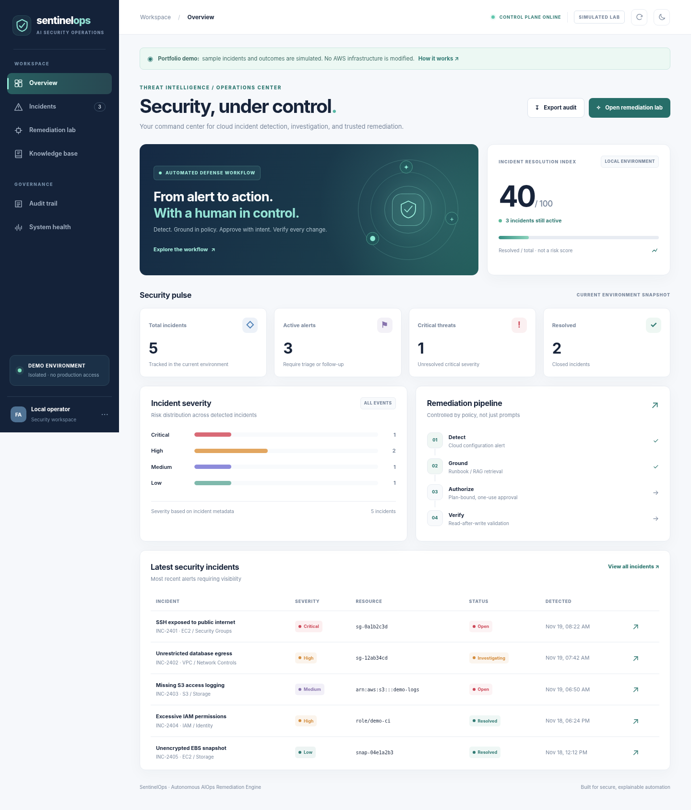
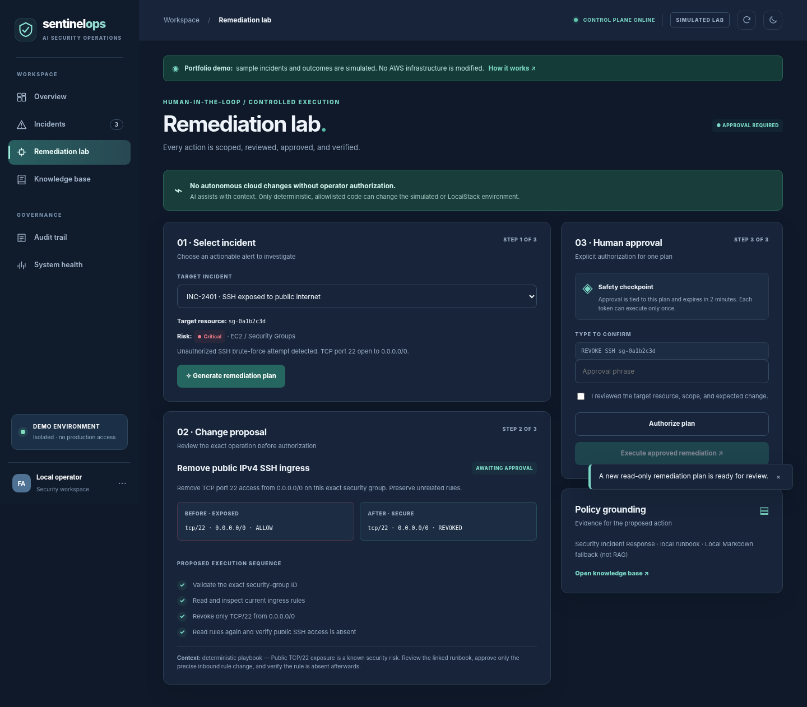

# SentinelOps · Autonomous AIOps Remediation Lab

**A portfolio-ready, human-approved cloud remediation dashboard** built around the original Autonomous AI-Ops Remediation Engine project. Demonstrates a practical Detect → Retrieve → Plan → Approve → Execute → Verify workflow with an optional ChromaDB RAG knowledge source and Ollama advisory analysis.

> **Scope:** local portfolio demo and LocalStack simulation. This is not production security software, is not authenticated, and must never be exposed to the public Internet. The default interface uses example incidents, not live cloud findings.

## Screenshot

After launching, the dashboard runs at **http://127.0.0.1:8501**. The images below are screenshots of the local simulated workflow (not real AWS telemetry).





See `docs/SCREENSHOTS.md` for a screenshot checklist.

## Quick start — zero installations

Requires **Python 3.11+**. From this project folder:

```bash
python3 api_server.py
# Open http://127.0.0.1:8501
```

The sample environment is intentionally simulated and labels itself **Portfolio demo**. Select **Remediation lab → Generate remediation plan → review → type exact approval phrase → authorize → execute**. The demo state updates, and an audit event records each step. **No AWS environment is accessed.** Click **System health → Reset demo scenario** to repeat.

`python3 app.py` is an equivalent entrypoint. **Do not use `streamlit run app.py`: this redesign has its own web frontend.**

## Optional LocalStack run

Launch LocalStack on your own machine, with EC2 support available at `127.0.0.1:4566`. For example, with Docker installed:

```bash
docker run --rm -d --name sentinelops-localstack -p 127.0.0.1:4566:4566 localstack/localstack
python3 -m pip install -r requirements.txt
python3 master_setup.py
AIOPS_MODE=localstack python3 api_server.py
```

`master_setup.py` **intentionally creates a vulnerable TCP/22 rule**, only through a Boto3 client hardcoded to `http://127.0.0.1:4566`, and writes `cloud_alert.json`. It never points at real AWS. The LocalStack execution path checks the precise resource, revokes only TCP/22 `0.0.0.0/0`, then checks the rule again. If the rule spans a broader port range, it refuses automated changes. API errors and failed verification are reported as failures. No AWS production integration exists.

On Windows PowerShell, use `$env:AIOPS_MODE="localstack"; python api_server.py` instead.

## Optional local RAG and LLM

```bash
python3 -m pip install -r requirements-ai.txt
python3 ingest_sops.py
# The frontend now labels the retrieved context as ChromaDB RAG.
```

Without ingestion, the knowledge base uses a **clearly labelled local Markdown fallback**. If you want a descriptive local LLM incident summary, install Ollama and pull a model, then run:

```bash
ollama pull mistral
AIOPS_ENABLE_OLLAMA=1 python3 api_server.py
```

Ollama output is strictly **advisory**. It cannot choose targets or execute Boto3. Optional AI dependencies and Ollama were not required for the baseline unit tests.

## Interface features

- Polished, responsive dark/light dashboard and mobile navigation
- Incident search, severity filters, detail drawer, resource metadata
- Runbook provenance (local Markdown fallback vs Chroma RAG)
- Visual before/after remediation diff and explicit plan steps
- Plan-bound operator approval via exact confirmation phrase
- Expiring single-use execution token and server-side authorization checks
- Post-action verification and explicit simulation labels
- Audit activity and downloadable CSV
- Runtime health and demo reset controls

## Architecture

```text
frontend/index.html + styles.css + app.js
       | same-origin HTTP + JSON
       v
api_server.py (127.0.0.1 only)
       |
       v
aiops/service.py  [alert state, plans, approvals, event audit]
       |--- aiops/integrations.py --> optional Chroma RAG / Ollama summaries
       |
       `--- aiops/core.py --------> exact SSH policy / Boto3 LocalStack adapter
```

**Trust boundary:** retrieval and LLM text cannot become tool arguments. Only server-created plans for the known SSH scenario are eligible for deterministic changes. A one-use plan-specific operator approval must exist before execution. The frontend alone is not the authorization boundary.

## Validation

```bash
python3 -m unittest discover -s tests -v
python3 -m compileall -q aiops api_server.py app.py master_setup.py ingest_sops.py reasoning_engine.py agent_execution.py test_retrieval.py
node --check frontend/app.js
```

CI repeats the Python checks and JavaScript syntax check. For LocalStack end-to-end verification, start LocalStack, generate an alert, run in localstack mode, approve the plan, and inspect the resulting ingress permissions.

## Migration from the original repository

This package is an **upgraded replacement** of the application layer, not a byte-for-byte copy of the historical repository. Copy these files into your existing repo root (replace the same-named original files); keep any separate `old_scripts/` and `company_docs/` material you want, but ensure the runbook used by the new frontend remains available. Original direct-agent code is replaced by a safe disabled stub, while the new `reasoning_engine.py` is read-only. `app.py` now starts the new interface (not Streamlit). See `docs/REVIEW.md` for line-of-code findings.

## Portfolio positioning

**Suggested resume entry** (edit to reflect your actual contributions):

**SentinelOps — Human-in-the-Loop AI Cloud Remediation Lab** | Python, JavaScript, LocalStack, Boto3, ChromaDB, Ollama

- Built a responsive security-operations console supporting incident triage, runbook retrieval, and plan-specific operator approval, with demo and LocalStack execution modes.
- Implemented deterministic SSH ingress remediation with strict resource validation, single-use authorization tokens, and post-action verification to prevent misleading success states.
- Added automated unit/API regression coverage, an auditable event stream, CSV export, and local-first setup documentation.

Avoid claiming measured MTTR improvements, SOC deployment, real AWS protection, or successful LLM/RAG integration until verified in your own environment.

## Important limitations

- No login, RBAC, multi-tenant architecture, long-term audit database, or remote host support.
- In-process approval tokens and demo audit log do not persist across restarts.
- Incident source is fixture data or a single local JSON alert, not a live CloudWatch integration.
- LocalStack and optional third-party ML integrations require separate installation and integration testing.
- Runbook matches are advisory; there is no policy-authoring governance or general-purpose remediation agent.

Licensed according to your original repository's license, if any; add an explicit license before public reuse.
